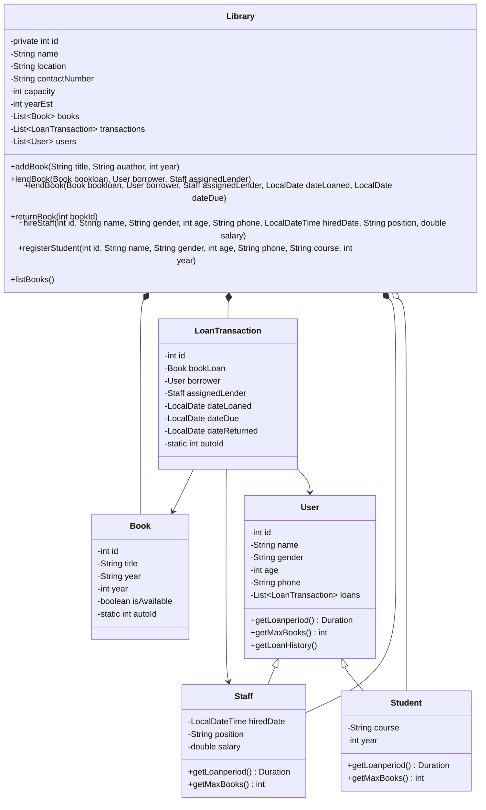

## Library-Management-System

The very start of this 5 man midterm project begins today (Tomorrow).

## Current Plans

- Week1: List Class and class attributes, analyze classes relationships, implement the initial skeleton of the classes [X]
- Week2: Implement the core features, menu, and apply the required OOP concepts. Plus Validation, error handling and Extra features if there's time.
- Week3: Extra features and testing. Then we start documentation and presentation slides.
- Week4: Continue with documentation and polishing plus presentation practice.

## Core Features

- Add a book (title, author, year)
- List all books, showing availability status
- Check out a book (mark as borrowed)
- Return a book (mark as available)

## Extra Features

- Search by title or author
- due dates and late fees
- track who borrowed which book

## File Structure

Still figuring it out.

## Class Relationships

