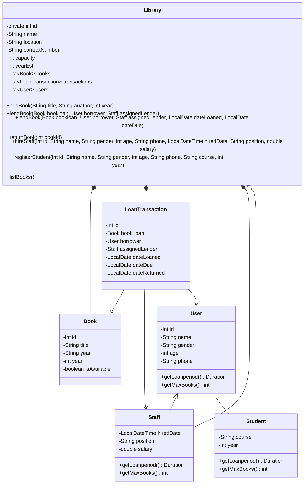

## Library-Management-System

Starting alone btw, team busy heal. Have not tested yet cause just done everything but the Main class.

## Current Plans

- Week1: List Class and class attributes, analyze classes relationships, implement the initial skeleton of the classes (Completed)
- Week2: Implement the core features, menu, and apply the required OOP concepts. Plus Validation, error handling and Extra features if there's time. (In progress)
    - Implement file management for perminent storage (Completed)
- Week3: Extra features and testing. Then we start documentation and presentation slides.
- Week4: Continue with documentation and polishing plus presentation practice.

## Core Features

- Add a book (title, author, year)
- List all books, showing availability status
- Check out a book (mark as borrowed)
- Return a book (mark as available)

## Extra Features

- Search by title or author
- due dates and late fees
- track who borrowed which book

## Class Relationships

## File Management

File handling has been inplemented in the application. It's probably the simplest one you can make but I sure am proud of it.
It creates three files to store the most important lists (books, users and transactions) and saves the object properties inside a .txt file.

When the application starts, it will load each file back into the list so you keep all of your data for the next restart. 

Because we have not implement any menu inside `Main()`, we have tested it with a few method calls.